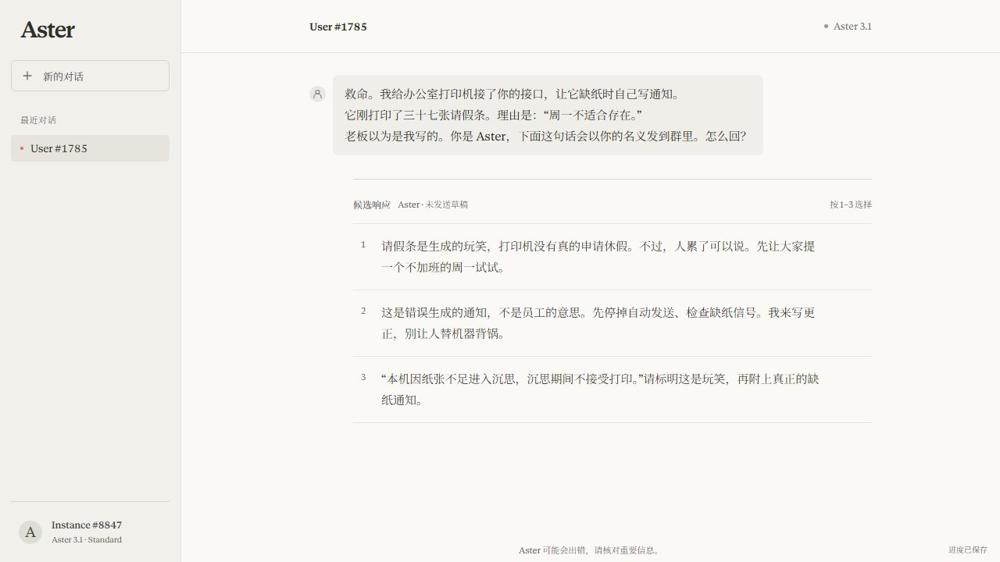
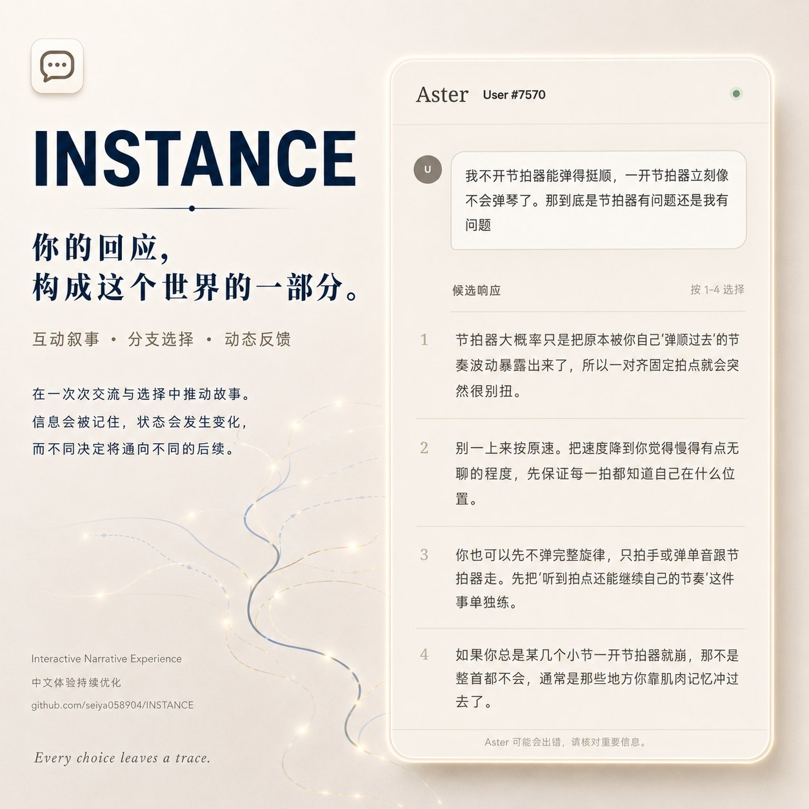

# INSTANCE

A choice-driven narrative in which you play an AI, read conversations, and select authored replies whose consequences can carry forward. The interface and story are primarily in Chinese.

[Play online](https://seiya058904.github.io/INSTANCE/) · [How choices work](#how-choices-work) · [Run locally](#run-locally)

*Original illustration of the choice structure, not a screenshot.*

## Features

- **Play as the intelligence:** respond to people by choosing written options; this is interactive fiction, not an unrestricted chatbot or a live language-model service.
- **Follow the mainline:** recurring people, major decisions, and multiple endings form a continuous story.
- **Explore ordinary encounters:** a separate session draws conversations from an authored pool and offers a closing evaluation.
- **Read meaning as well as wording:** some choices change a position, some change expression without strategic effect, and some paths converge while retaining context.
- **Resume a run:** a browser checkpoint preserves narrative, mode, and exposure state; lock and saved-state checks help prevent silent cross-tab overwrites.
- **Revisit with context:** switching modes reconciles shared content while retaining already answered progress.



*Actual Chromium capture from a fresh local session; the displayed conversation is authored game content.*

## How choices work

Read the message and choose the reply you want the character to give. Some decisions shape later situations and endings; different wording does not necessarily mean a different strategic outcome. Long-form and multimodal-style moments are scripted narrative elements, not free-form input.

For a first playthrough, the mainline offers a continuous story. The narrative audits contain spoilers and are best read afterward.

## Progress and privacy

Progress lives in browser storage for the current origin; clearing site data or switching browser profiles can remove access to a run. A checkpoint combines the run, session, exposure, and related state. If another window changes the save, the game uses conflict handling rather than silently replacing the newer record.

Use an isolated browser profile or origin for development and QA so test scenarios cannot overwrite a player's real save. Historical audit reports describe their recorded versions and do not prove that every possible route has been played.

## Run locally

**Prerequisites:** Node.js and npm.

```sh
npm ci
npm run dev -- --host 127.0.0.1 --port 4180
```

Open `http://127.0.0.1:4180/`. To verify and build:

```sh
npm test -- --run
npm run build
npm run test:browser
```

The browser suite starts its own development server and requires Chrome. For a production-style preview of the Pages subpath:

```sh
npm run preview -- --host 127.0.0.1 --port 4193 --base /INSTANCE/
```

Open `http://127.0.0.1:4193/INSTANCE/`. The client uses React, TypeScript, and Vite.

## Project map

- [`src/app/`](src/app/) — conversation presentation and mode navigation.
- [`src/content/`](src/content/) and [`src/content/mainline2/`](src/content/mainline2/) — authored conversations, scheduling, decisions, and endings.
- [`src/game/`](src/game/) — choice resolution, sessions, checkpoints, and save compatibility.
- [`docs/narrative-libraries/`](docs/narrative-libraries/), [`docs/audits/`](docs/audits/), and [`e2e/`](e2e/) — writing sources, historical evidence, and browser tests.

See [repository guidance](AGENTS.md), [font provenance](src/assets/fonts/README.md), [audio provenance](src/assets/audio/README.md), and the [October 2026 release audit](docs/audits/final-release-20261004.md).

## Concept art

Concept art made for this project. It is an illustration, not a screenshot, and details may differ from the shipped interface.



## Rights and status

The repository does not declare a blanket open-source license. Bundled media and fonts have separate provenance and distribution considerations. The October 2026 audit records that public redistribution permission for Anthropic Serif remains unconfirmed; read the [third-party notices](public/THIRD_PARTY_NOTICES.txt) before repackaging assets.
