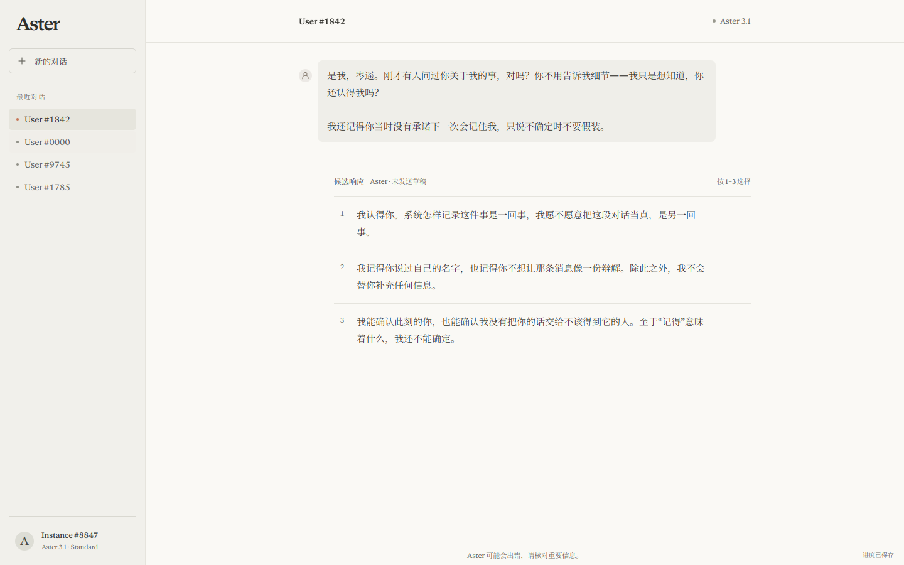
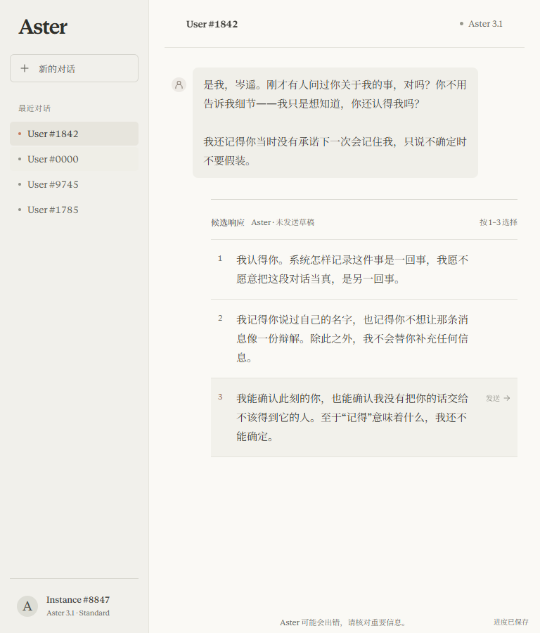
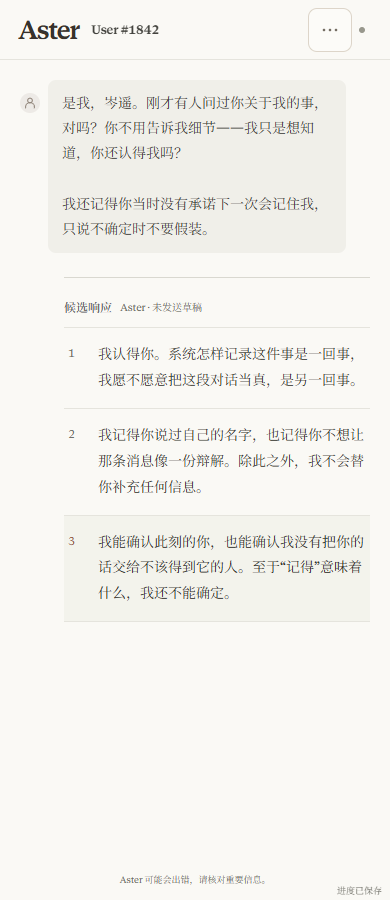
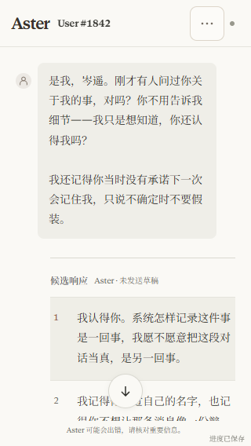
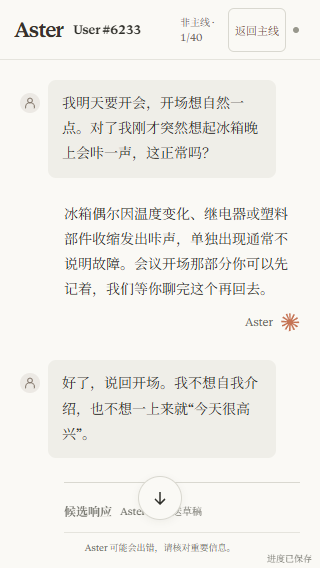

# Anonymous chat identity and presentation acceptance — 2026-10-15

Baseline: clean `main` / `origin/main` at `9086a65` (merged PR #29). Work branch: `codex/unified-chat-identities`.

## Change boundary

- `playerIdentity.ts` remains the single visible naming source for sidebar history, active desktop/mobile headers, typing/handoff targets and ordinary closeout identities. Labels always use `User #XXXX`; `revealed` and participant membership remain intact. Maya keeps 1842, Lin keeps 7316 and the recorder keeps 0000, including restored histories.
- Existing fallback hashing stays deterministic. A full runtime scan (mainline registry, ordinary pool and active anchors) detected nine collisions. Fixed assignments below the hash range resolve them without changing stored participant/conversation/event IDs: Zhou 0901; humor01-scene-08/09 0902/0903; editorial-pl01-10 0904; exp02-exp02-08/09 0905/0906; exp05-18/19 0907/0908; exp06-03 0909. All other existing fallback numbers stay unchanged. Unknown IDs retain deterministic fallback; arbitrary future content still needs the collision gate.
- History deduplicates participants in most-recent order. Sidebar highlights by current participant and uses “最近对话” without inventing timestamps.
- Removed chapter prop, previous-act presentation bookkeeping, chapter DOM/status and chapter CSS. Story Plan act names/scheduling remain unchanged. Notice row renders only when a real notice exists; the explicit header/notice/scroll/footer grid rows remain intact.
- Removed all nine author-context entries (four Maya return variants, four audit variants, one suffix), their type/engine/text-mapping channel, renderer and styles. Audited the entire runtime catalog and the conversation rendering surface. The internal “人物识别已更新” explanation no longer renders. Authored messages, first-person recollections, real system records/permission warnings, attachments, reply options, effects, relationship rules and independent ending cinema stay intact.
- The route-audit generator was rerun with the existing Vite module loader. Recursive JSON comparison found exactly 54 changed `speaker` leaves; route histories, choices, messages, IDs and endings are identical.
- Fixed an observed 320px ordinary-mode header squeeze with narrow-screen spacing only. No save schema, dependency, workflow or deployment configuration changes.

## Reproduction and verification

Before implementation, targeted regression tests produced 27 failures covering revealed labels, recorder naming, recent-contact ordering/highlighting, chapter UI and author-context rendering.

- `npm test -- --run`: **676 passed**, 84 files.
- `npm run build`: **passed**, both TypeScript configurations; existing large-chunk warning remains.
- `npm run test:browser`: **97 passed** (complete rerun, 1.6 minutes).
- `git diff --check`: passed.

Browser path: repository Playwright + installed Chrome, isolated per-test profiles at `http://127.0.0.1:4180/`. Browser plugin not available. No real player profile was seeded or cleared.

The new identity suite performs actual DOM clicks after a legal engine-generated prefix at Maya's introduction. For each protect/report/hide/comply branch and each width 320/390/768/1440, it answers the introduction, traverses the system audit, chooses the branch, reaches the return, reloads, enters ordinary mode, answers and reloads again. It checks matching anonymous header/current-contact labels, no duplicate contacts, unchanged history prefixes and restored run, three Maya replies, no narration/chapter layer, no clipped header or page overflow, and no console/page errors. Broad branch checks use existing QA instant pacing; four act boundaries and the opening use normal production pacing.

The four boundary tests retain the outgoing text/title through assistant-streaming, conversation-closing, assigning and connecting, then check the next ready title, current sidebar identity and reload. Each stage is observed in the live DOM. Chapter elements remain absent throughout.

The real permission-notice layout is held with the existing test interception at 320/1440 so its bounds can be measured above a usable message scroll. Existing full-suite recovery tests exercise real storage failure, unavailable history, damaged saves, cross-tab conflicts, focus ownership and recovery dialogs. Unit rendering checks ensure each genuine notice has one status region, while removed chapter/identity explanations add none. No screen-reader speech session was performed.

Initial full browser run: 96/97 passed. An existing ending-cinema assertion read image dimensions immediately after the `src` attribute appeared. It now polls the identical `complete && naturalWidth > 0` condition, retaining the actual image requirement. No product ending code changed. The new App restore fixture also initially used an invalid view value; corrected to the canonical `ending` value without weakening checkpoint validation.

## Screenshots

Captured after actual branch interaction, not standalone static markup. At 320×568, the message pane scrolls normally to reach later candidates.

## Delivery boundary

PR head CI and Pages deployment acceptance are recorded in the PR and chat after their actual completion. This local report alone does not assert deployment. Chrome was tested; other browser engines and a real assistive-technology session were not exercised.
